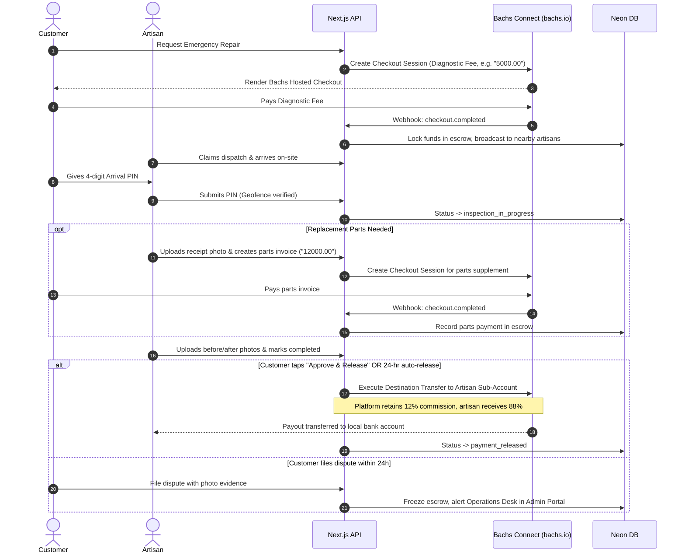

# Skilled4U — System Specification & Implementation Plan

> **The On-Demand Artisan & Home Services Platform ("Uber for Artisans")**  
> Connecting verified skilled professionals (Plumbing, Electrical, Electronics, Carpentry, HVAC, Painting, Appliances) with residential and commercial customers.

---

## 1. Executive Summary & Product Alignment

Finding trustworthy, vetted artisans for household and commercial repairs is plagued by unpredictability, price gouging, lack of accountability, and safety concerns. Traditional word-of-mouth recommendations fail during emergencies (e.g., burst pipes, power outages, AC breakdowns), and existing classifieds offer zero quality guarantee or payment security.

**Skilled4U** bridges this gap as a modern, two-sided on-demand marketplace:
1. **For Customers:** Instant or scheduled booking of verified artisans nearby, upfront transparent pricing / diagnostic fees, live GPS tracking via Mapbox, in-app chat with photo sharing, secure milestone/escrow payments powered by **Bachs Connect** ([bachs.io](https://bachs.io)), and work warranties.
2. **For Artisans:** A steady stream of verified local jobs, digital identity and reputational credit score, instant or scheduled payouts in their local currency, clear job specifications, and safety protections against non-payment.
3. **For Business / Platform Owners:** Centralized admin portal for KYC vetting, dispute resolution with photo evidence, commission management, and automated dispatches.

---

## 2. Architecture & Monorepo Surfaces

```
skilled4u-monorepo/
├── apps/
│   ├── mobile/         # Expo SDK 58 (React Native) iOS & Android — NativeWind v4 (Tailwind CSS)
│   └── web/            # Next.js 16 (App Router) — Marketing Landing Page & Admin Operations Portal
└── packages/
    ├── shared/         # Zod schemas, TypeScript contracts, shared DTOs & constants
    ├── database/       # Drizzle ORM schema, migrations, connection pool (Neon PostgreSQL + PostGIS)
    └── ui/             # Cross-platform shared design tokens, colors & icons
```

### Surface Responsibilities

* **`apps/mobile` (Expo SDK 58 / React Native / NativeWind v5 & Tailwind CSS v4):**
  * Dynamic role-based UI switching between **Customer Mode** and **Artisan Pro Mode** from a single authenticated account.
  * Customer Mode: Progressive guest triage, interactive onboarding questionnaire, service catalog, emergency broadcast dispatch, direct booking calendar, Mapbox live artisan route tracking, 4-digit arrival PIN display, Bachs escrow checkout, in-app chat, rating/review submission.
  * Artisan Pro Mode: KYC document upload, active duty toggle (online/offline), high-priority audio push dispatch notifications, turn-by-turn navigation, geofenced arrival PIN verification, supplementary parts invoice builder with receipt photo, before/after proof-of-work photo upload, Bachs Connect bank payout management.

* **`apps/web` (Next.js 15+ App Router / Tailwind CSS v4 / Shadcn UI):**
  * Marketing landing page with SEO-optimized service catalog, location landing pages, and mobile app download links.
  * Admin & Operations Portal (`/admin/*`): Manual artisan KYC verification queue, live dispatch radar, dispute resolution mediation console, commission & diagnostic fee configuration.
  * Centralized Route Handlers (`/api/*`): Better Auth endpoints, Bachs webhook receiver (`/api/webhooks/bachs`), and core REST/tRPC services.

* **`packages/database` (Neon PostgreSQL + PostGIS + Drizzle ORM):**
  * Sub-millisecond geospatial queries via PostGIS (`ST_DWithin`, `ST_Point`) for proximity-based dispatching.
  * ACID transaction safety for job state transitions and financial escrow ledgering.

* **`packages/shared`:**
  * Shared Zod schemas, status enums, TypeScript interfaces, and pricing calculation logic.

---

## 3. Technology Stack & Exact Versions

| Component | Technology | Version / Specification |
|---|---|---|
| **Mobile Framework** | Expo / React Native | Expo SDK `~58.0.19`, React Native `0.88.0`, React `19.3.0` |
| **Mobile Navigation** | Expo Router | `~58.0.26` (file-based routing in `src/app`) |
| **Mobile Styling** | NativeWind | `v5` (`5.0.0-rc.0` with `react-native-css` & Tailwind CSS `v4`) |
| **Web Framework & UI** | Next.js + Shadcn UI | Next.js `15.5+` (App Router), Tailwind CSS `v4.3+`, Shadcn UI |
| **Database & ORM** | Neon PostgreSQL + PostGIS | Drizzle ORM `^0.39.0` with `drizzle-kit` |
| **Authentication** | Better Auth | Self-hosted on Next.js backend with Email/Password & Google OAuth |
| **Payments & Escrow** | Bachs Connect | `@bachs/sdk` ([bachs.io](https://bachs.io)) — Marketplace Split Payments |
| **Real-Time Layer** | Managed Realtime Channel | Supabase Realtime / Pusher (WebSocket pub/sub for GPS & chat) |
| **Mapping & Routing** | Mapbox SDK | `@rnmapbox/maps` for mobile rendering, Mapbox Directions API |
| **Media Storage** | Cloudinary | Direct signed uploads with auto-compression & WebP delivery |
| **Push Notifications** | Expo Notifications | High-priority background alerts (APNs / FCM) |
| **AI Fault Triage** | SkilledAI | Lightweight Gemini / OpenAI classifier for trade & symptom triage |
| **Observability** | Sentry + Pino | Error tracking across mobile/web and structured JSON audit logs |

---

## 4. Financial & Payment Architecture (Bachs Connect)

All payment operations adhere strictly to the **Bachs Money Standard** ([bachs.io](https://bachs.io)):
- **Money is always a decimal string at currency precision** (e.g. `"15000.00"`, `"25.00"`), paired with an ISO 4217 currency code (e.g. `NGN`, `USD`, `KES`). **Never minor units (cents/kobo)**.
- **Webhooks are the sole source of truth** for payment fulfillment (`checkout.completed`, `transfer.created`).

### Payment Flow & Split Escrow Model



---

## 5. Core Data Model (Drizzle ORM)

### Key Database Tables

```typescript
// packages/database/src/schema.ts

import { pgTable, text, timestamp, boolean, decimal, integer, jsonb, geometry, pgEnum } from "drizzle-orm/pg-core";

export const userRoleEnum = pgEnum("user_role", ["customer", "artisan", "admin", "operator"]);
export const kycStatusEnum = pgEnum("kyc_status", ["unsubmitted", "pending", "verified", "rejected"]);
export const bookingStatusEnum = pgEnum("booking_status", [
  "broadcasted",
  "claimed",
  "en_route",
  "arrived",
  "in_progress",
  "completed",
  "disputed",
  "cancelled"
]);
export const paymentStatusEnum = pgEnum("payment_status", ["held_in_escrow", "transferred", "refunded", "disputed"]);

export const users = pgTable("users", {
  id: text("id").primaryKey(), // CUID / UUID
  name: text("name").notNull(),
  email: text("email").notNull().unique(),
  phone: text("phone").notNull().unique(),
  role: userRoleEnum("role").default("customer").notNull(),
  avatarUrl: text("avatar_url"),
  createdAt: timestamp("created_at", { withTimezone: true }).defaultNow().notNull(),
  updatedAt: timestamp("updated_at", { withTimezone: true }).defaultNow().notNull()
});

export const artisanProfiles = pgTable("artisan_profiles", {
  id: text("id").primaryKey(),
  userId: text("user_id").references(() => users.id, { onDelete: "cascade" }).notNull().unique(),
  tradeCategory: text("trade_category").notNull(), // plumbing, electrical, hvac, carpentry, etc.
  experienceYears: integer("experience_years").notNull(),
  bio: text("bio"),
  kycStatus: kycStatusEnum("kyc_status").default("unsubmitted").notNull(),
  ratingAvg: decimal("rating_avg", { precision: 3, scale: 2 }).default("5.00").notNull(),
  ratingCount: integer("rating_count").default(0).notNull(),
  diagnosticRate: text("diagnostic_rate").notNull(), // Bachs decimal string, e.g. "5000.00"
  hourlyRate: text("hourly_rate").notNull(),
  serviceRadiusKm: integer("service_radius_km").default(15).notNull(),
  currentLocation: geometry("current_location", { type: "point", mode: "xy", srid: 4326 }),
  isOnline: boolean("is_online").default(false).notNull(),
  bachsAccountId: text("bachs_account_id"), // acct_... in Bachs Connect
  createdAt: timestamp("created_at", { withTimezone: true }).defaultNow().notNull()
});

export const artisanDocuments = pgTable("artisan_documents", {
  id: text("id").primaryKey(),
  artisanId: text("artisan_id").references(() => artisanProfiles.id, { onDelete: "cascade" }).notNull(),
  documentType: text("document_type").notNull(), // national_id, trade_cert, police_clearance
  documentUrl: text("document_url").notNull(),
  verifiedAt: timestamp("verified_at", { withTimezone: true }),
  rejectionReason: text("rejection_reason"),
  createdAt: timestamp("created_at", { withTimezone: true }).defaultNow().notNull()
});

export const bookings = pgTable("bookings", {
  id: text("id").primaryKey(),
  bookingNumber: text("booking_number").notNull().unique(),
  customerId: text("customer_id").references(() => users.id).notNull(),
  artisanId: text("artisan_id").references(() => artisanProfiles.id),
  type: text("type").notNull(), // emergency_broadcast, scheduled
  categoryId: text("category_id").notNull(),
  issueDescription: text("issue_description").notNull(),
  customerLocation: geometry("customer_location", { type: "point", mode: "xy", srid: 4326 }).notNull(),
  customerAddress: text("customer_address").notNull(),
  status: bookingStatusEnum("status").default("broadcasted").notNull(),
  arrivalPin: text("arrival_pin").notNull(), // 4-digit code
  diagnosticFee: text("diagnostic_fee").notNull(), // decimal string
  quoteAmount: text("quote_amount"),
  totalAmount: text("total_amount").notNull(),
  currency: text("currency").default("NGN").notNull(),
  scheduledAt: timestamp("scheduled_at", { withTimezone: true }),
  completedAt: timestamp("completed_at", { withTimezone: true }),
  autoReleaseAt: timestamp("auto_release_at", { withTimezone: true }),
  createdAt: timestamp("created_at", { withTimezone: true }).defaultNow().notNull()
});

export const payments = pgTable("payments", {
  id: text("id").primaryKey(),
  bookingId: text("booking_id").references(() => bookings.id).notNull(),
  bachsCheckoutSessionId: text("bachs_checkout_session_id").notNull().unique(),
  bachsTransferId: text("bachs_transfer_id"),
  grossAmount: text("gross_amount").notNull(), // decimal string e.g. "5000.00"
  platformFee: text("platform_fee").notNull(), // e.g. "600.00" (12%)
  artisanPayout: text("artisan_payout").notNull(), // e.g. "4400.00"
  currency: text("currency").notNull(),
  status: paymentStatusEnum("status").default("held_in_escrow").notNull(),
  createdAt: timestamp("created_at", { withTimezone: true }).defaultNow().notNull()
});

export const supplementaryInvoices = pgTable("supplementary_invoices", {
  id: text("id").primaryKey(),
  bookingId: text("booking_id").references(() => bookings.id).notNull(),
  description: text("description").notNull(),
  receiptPhotoUrl: text("receipt_photo_url").notNull(),
  amount: text("amount").notNull(), // decimal string
  currency: text("currency").notNull(),
  bachsCheckoutSessionId: text("bachs_checkout_session_id"),
  isPaid: boolean("is_paid").default(false).notNull(),
  createdAt: timestamp("created_at", { withTimezone: true }).defaultNow().notNull()
});

export const messages = pgTable("messages", {
  id: text("id").primaryKey(),
  bookingId: text("booking_id").references(() => bookings.id).notNull(),
  senderId: text("sender_id").references(() => users.id).notNull(),
  content: text("content").notNull(),
  mediaUrl: text("media_url"),
  createdAt: timestamp("created_at", { withTimezone: true }).defaultNow().notNull()
});

export const reviews = pgTable("reviews", {
  id: text("id").primaryKey(),
  bookingId: text("booking_id").references(() => bookings.id).notNull(),
  reviewerId: text("reviewer_id").references(() => users.id).notNull(),
  targetId: text("target_id").references(() => users.id).notNull(),
  rating: integer("rating").notNull(), // 1 - 5
  punctuality: integer("punctuality").notNull(),
  craftsmanship: integer("craftsmanship").notNull(),
  cleanliness: integer("cleanliness").notNull(),
  comment: text("comment"),
  createdAt: timestamp("created_at", { withTimezone: true }).defaultNow().notNull()
});

export const disputes = pgTable("disputes", {
  id: text("id").primaryKey(),
  bookingId: text("booking_id").references(() => bookings.id).notNull(),
  initiatorId: text("initiator_id").references(() => users.id).notNull(),
  reason: text("reason").notNull(),
  evidenceUrls: jsonb("evidence_urls").default([]).notNull(),
  status: text("status").default("open").notNull(), // open, resolved_refund, resolved_release, resolved_split
  resolutionNotes: text("resolution_notes"),
  resolvedById: text("resolved_by_id").references(() => users.id),
  createdAt: timestamp("created_at", { withTimezone: true }).defaultNow().notNull()
});
```

---

## 6. Implementation Roadmap (Phases 1 – 8)

### Phase 1: Monorepo Foundation & Workspace Tooling
* [x] Initialize Turborepo / npm workspaces containing `apps/mobile`, `apps/web`, `packages/shared`, `packages/database`, and `packages/ui`.
* [x] Configure TypeScript, ESLint, Prettier, and NativeWind v4 across packages.
* [x] Set up environment configuration files (`.env.example`) with strict type validation using `@t3-oss/env-core`.

### Phase 2: Database Schema & PostGIS Spatial Setup
* [ ] Provision Neon PostgreSQL instance with PostGIS extension enabled (`CREATE EXTENSION IF NOT EXISTS postgis;`).
* [ ] Implement Drizzle ORM schema definitions in `packages/database`.
* [ ] Generate initial migrations with `drizzle-kit generate` and run migration runner.
* [ ] Implement spatial helper functions:
  * `findNearbyOnlineArtisans(category, customerLat, customerLng, radiusMeters)` using `ST_DWithin` and spatial indexing.

### Phase 3: Better Auth Integration (Web & Mobile)
* [ ] Configure Better Auth on Next.js server (`apps/web/src/lib/auth.ts`) supporting Email/Password and Google OAuth.
* [ ] Set up secure token storage on mobile (`expo-secure-store`) for bearer tokens.
* [ ] Implement mobile auth state machine & context (`useAuth`, login, sign up, session refresh).
* [ ] Add multi-role authorization guards for `customer`, `artisan`, and `admin`.

### Phase 4: Artisan KYC & Admin Operations Portal
* [ ] Build interactive Artisan Onboarding questionnaire in mobile app.
* [ ] Integrate Cloudinary pre-signed image upload flow for National IDs, certifications, and profile selfies.
* [ ] Build Next.js Admin Operations Portal (`/admin/kyc`):
  * Document verification review queue with side-by-side photo inspection.
  * One-click approval / rejection with structured rejection reasons.
* [ ] Build Admin Live Dispatch Radar (`/admin/radar`) displaying active jobs and online pros.

### Phase 5: Booking, Dispatch Engine & Mapbox Live Tracking
* [ ] Implement emergency dispatch broadcast worker with progressive radius expansion (5km for 60s → 10km for 60s).
* [ ] Configure high-priority Expo Push Notifications with custom audio for incoming job broadcast alerts.
* [ ] Implement Mapbox SDK on mobile (`@rnmapbox/maps`):
  * Artisan en-route live route line and ETA calculation.
  * Real-time GPS coordinate streaming over Managed Realtime WebSocket channel.
* [ ] Implement 4-digit Arrival PIN generation & geofenced arrival verification.

### Phase 6: In-App Messaging, Media Sharing & Supplementary Parts
* [ ] Build real-time 1-on-1 chat screen with photo and voice note attachments.
* [ ] Implement artisan "Supplementary Parts Invoicing" tool:
  * Camera capture of hardware store receipt.
  * Line-item description and decimal string amount.
  * Customer instant approval and in-app payment trigger.

### Phase 7: Bachs Connect Payments & Escrow Settlement
* [ ] Integrate `@bachs/sdk` client in `apps/web/src/lib/bachs.ts`.
* [ ] Build checkout session generator for diagnostic fees and supplementary invoices.
* [ ] Implement secure webhook handler (`/api/webhooks/bachs`) verifying signature and handling:
  * `checkout.completed`: Releases booking from `broadcasted` to active dispatch.
  * `transfer.created`: Updates payout ledger to `transferred`.
* [ ] Implement 2-factor escrow release mechanism:
  * Customer taps "Approve & Release" OR automated cron releases after 24 hours.
  * Commission deduction (12%) and destination transfer to artisan's Bachs sub-account.
* [ ] Build dispute mediation console in Web Admin with funds freeze/refund tools.

### Phase 8: Hardening, Polish & Pre-Launch Testing
* [ ] Conduct end-to-end simulated emergency dispatch lifecycle tests.
* [ ] Perform offline resilience testing (network cut during arrival PIN entry).
* [ ] Set up Sentry error monitoring and Pino structured audit logs.
* [ ] Build production binaries with Expo Application Services (`eas build`).

---

## 7. Verification & Definition of Done

Before declaring the v1 platform ready for production pilot:
1. **Lint & Typecheck:** Both `apps/mobile` and `apps/web` must pass `npx expo lint`, `npm run lint`, and `tsc --noEmit` with zero errors.
2. **End-to-End Happy Path:**
   - A customer books an emergency repair and completes diagnostic fee payment on Bachs checkout.
   - An artisan within 5km receives a high-priority push notification and claims the job.
   - Customer tracks the artisan's Mapbox GPS marker moving live.
   - Artisan arrives, enters the customer's 4-digit PIN, and starts the timer.
   - Artisan uploads a hardware receipt for replacement parts; customer pays in-app.
   - Artisan completes work with before/after photos; customer approves.
   - Bachs executes the split transfer (12% platform fee retained, 88% sent to artisan bank).
   - Both users successfully rate and review each other.
3. **Dispute & Refund Path:** A simulated dispute freezes escrow in Neon, presents evidence to the admin dashboard, and allows ops staff to execute a split or full refund.
